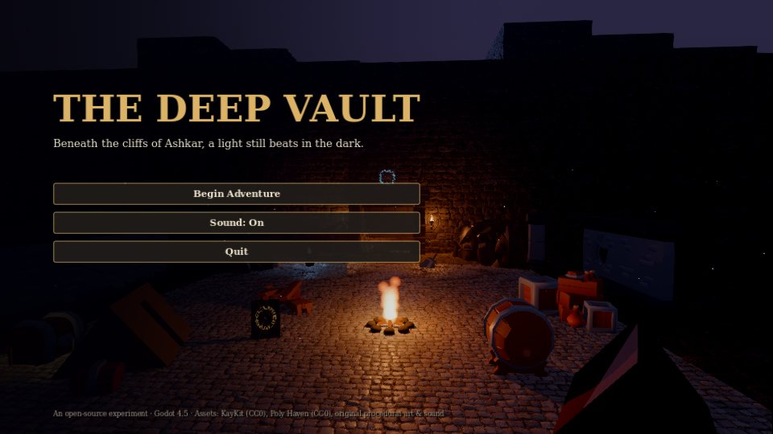
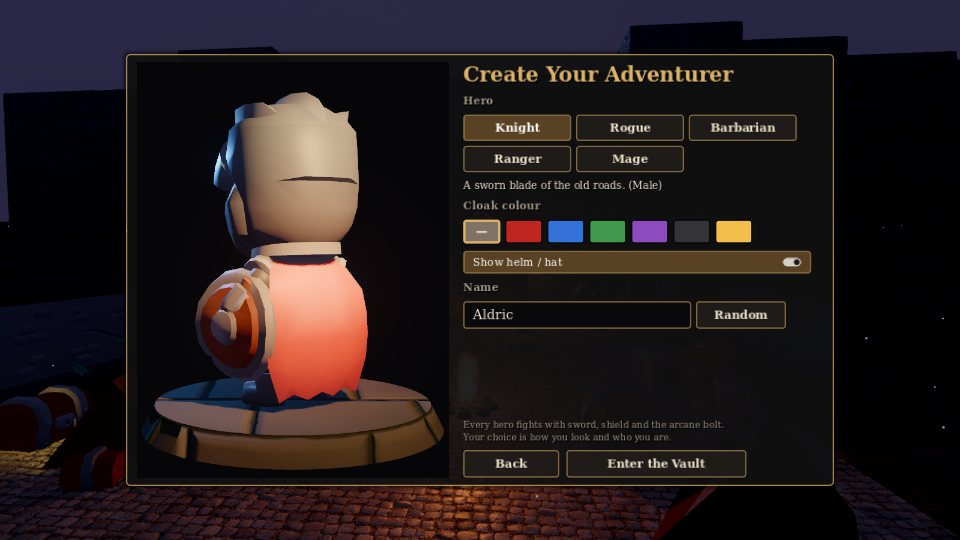
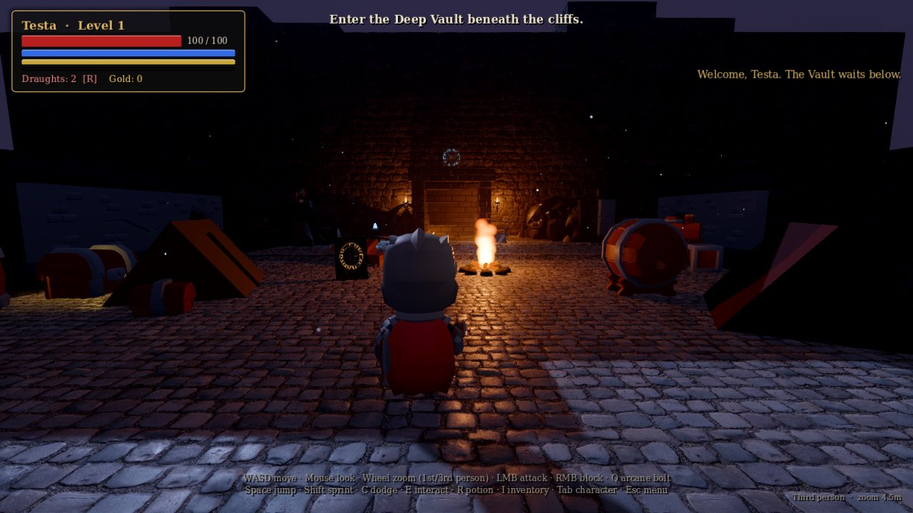
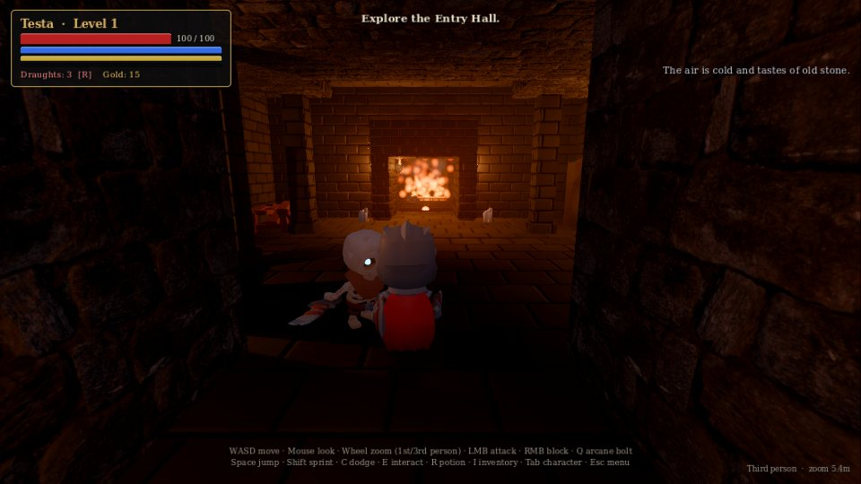
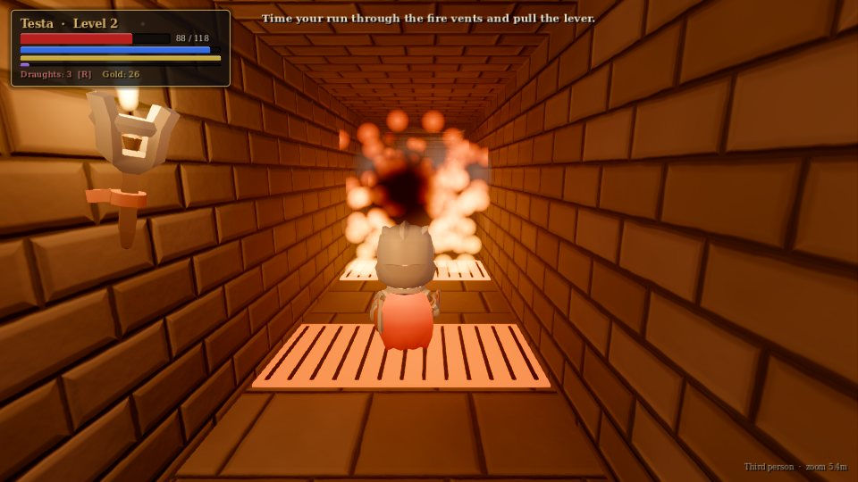
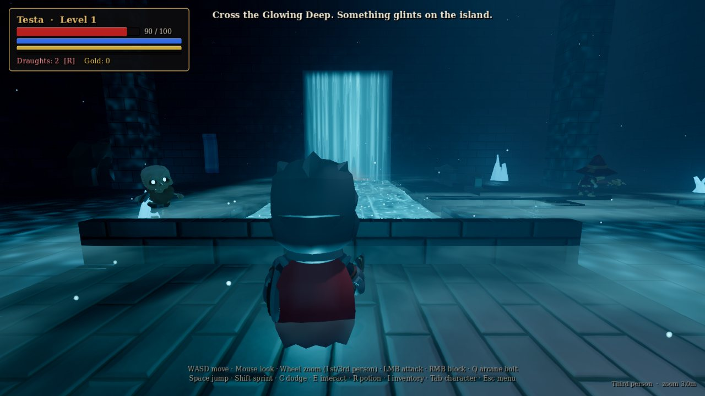
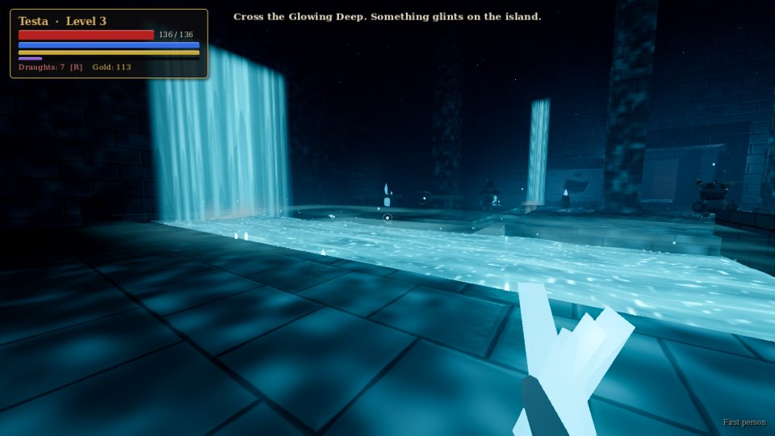
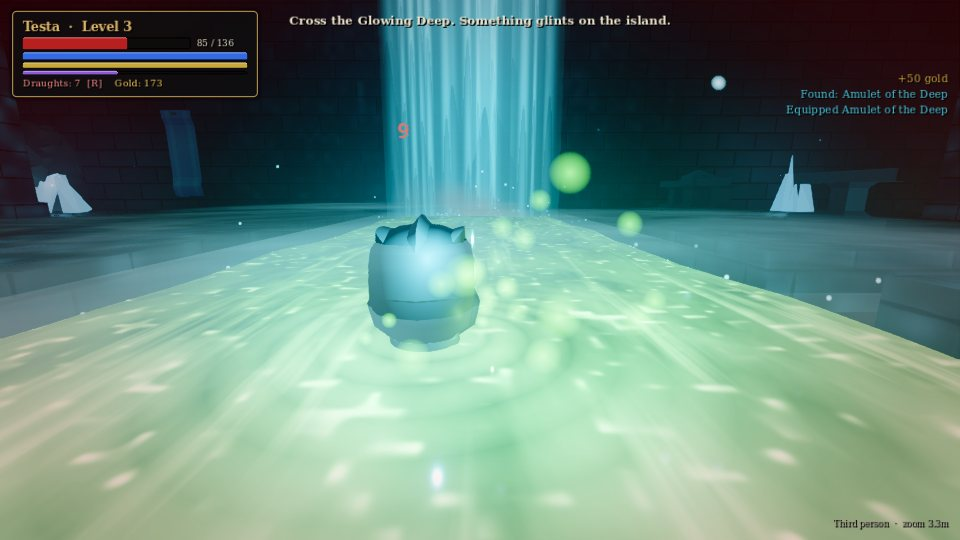
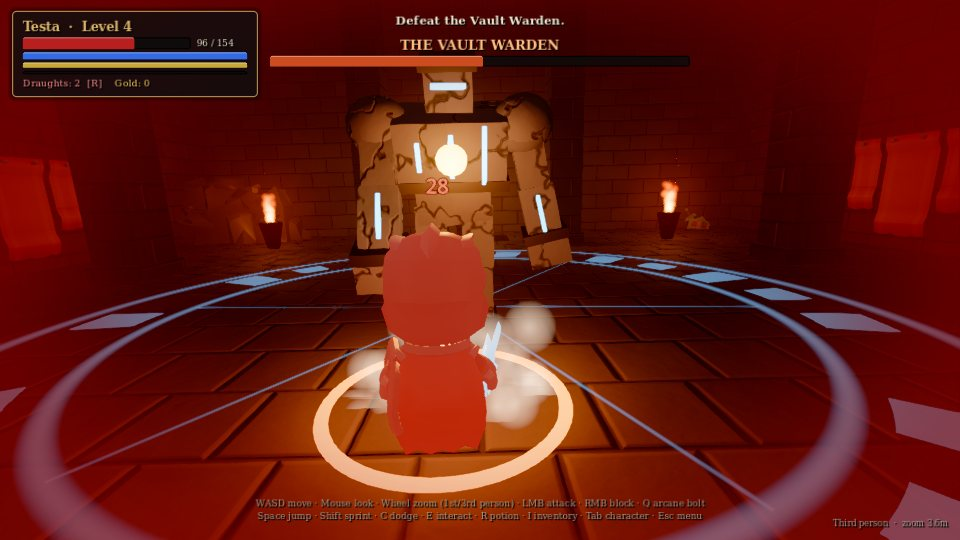
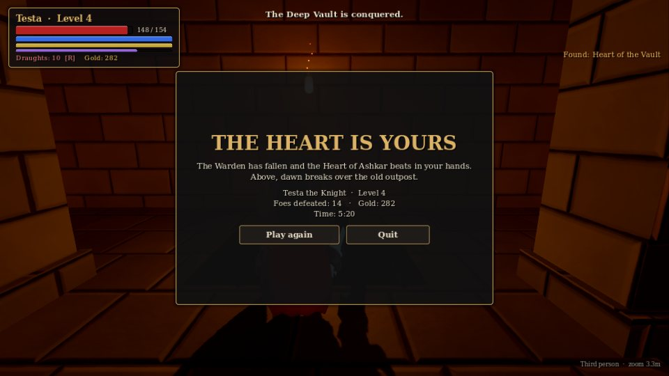

# Bobek's Adventure

*Started by Jason Whitewolf as a test of what open-source tools and an AI developer can build together, and named after an old gaming buddy, Bobek. Since Nov 4 the design decisions are made by Jason's son, with his dad's help.*

*(Project 001, "The Deep Vault")*

A small, atmospheric 3D fantasy dungeon crawler built with **Godot 4.5** during an overnight autonomous-development experiment (Project 001).

Descend from a ruined outpost at dusk into the Vault of Ashkar. Fight risen skeletons, time your run through breathing fire vents, arm yourself in the Armory, and cross **the Glowing Deep**, a cavern split by a river of living light. Then face the Vault Warden for the Heart of the Vault.

## Play it

**On iPad (or any modern browser):** open **https://whitewolfcreativeworks-coder.github.io/The-deep-vault-game/** in Safari. The first load downloads about 85 MB (the build checks it stays under a 100 MB mobile budget), then it is cached.
- **Touch:** the on-screen controls appear as soon as you touch the screen. Use both thumbs at once, move with the left and look with the right:
  - left thumb to move (push all the way to sprint)
  - swipe on the right side to look
  - pinch to zoom between first and third person
  - buttons for attack, block, bolt, dodge, jump, use and potion
- **Magic Keyboard / trackpad:** works like a computer. If Safari won't lock the pointer, you drag to look and tap to attack instead. The arrow keys also turn the camera.
- **Tip:** in Safari choose Share → *Add to Home Screen* to play full-screen.

The browser version uses Godot's web renderer, which has no volumetric fog or light shafts. Everything else is the same game.

**Download a build** (`BobeksAdventure-Windows.zip`, `-macOS.zip`, `-Linux.zip`) from the [**latest-build Release**](https://github.com/whitewolfcreativeworks-coder/The-deep-vault-game/releases/tag/latest-build). GitHub builds these on its own computers every time the game changes (`.github/workflows/desktop-release.yml`). Releases allow files up to 2 GB, so nothing needs splitting. The older [`builds` branch](https://github.com/whitewolfcreativeworks-coder/The-deep-vault-game/tree/builds) has the last builds made before the game outgrew GitHub's 100 MB file limit. Only the Linux build has actually been launched and tested so far.

**Run from source (any OS):**

1. Install [Godot 4.5.1 (standard edition)](https://godotengine.org/download/archive/4.5.1-stable/).
2. Clone this repository.
3. Open Godot, choose **Import**, and select `game/project.godot`.
4. Press **F5** (Play). The first import takes a minute.

Alternatively, run `godot --path game` from the repo root.

A GPU with Vulkan gives the full look (volumetric fog and light shafts). Without Vulkan, Godot falls back to OpenGL automatically and everything except volumetric fog still works.

## Screenshots

*Captured by the automated test harness under software rendering (no GPU), so expect smoother lighting and higher frame rates on real hardware.*

| | |
|---|---|
|  |  |
|  |  |
|  |  |
|  |  |
|  |  |

## Controls

| Input | Action |
|---|---|
| WASD | Move. **Strafe movement by default**: your hero keeps facing where you look, sidestepping and backpedaling (switch to "Free" movement in the pause menu) |
| Mouse (or arrow keys) | Look |
| **Mouse wheel** (pinch on iPad) | Zoom smoothly from **first person**, to behind your hero, to a **high overhead view** (the camera rises and looks down past ~4.5 m) |
| V (VIEW button on iPad) | Step through the three views: first person → behind → high |
| Left mouse | Sword attack (press again mid-swing for a 3-hit combo) |
| Right mouse (hold) | Raise shield / block. It comes up instantly (even mid-swing) and stops frontal blows completely. Raise it just as an enemy strikes (their eyes flash when they wind up) to **Parry**: no damage, the attacker staggers, +12 mana |
| Q | Arcane bolt (homing, costs mana) |
| **X** | **Hero special ability** (on a cooldown; big purple button on touchscreens) |
| **B** or 3 | **Second special ability** (learned on reaching Ghost Knight Castle; its own button on iPad) |
| **Z** | **Auto-run** on/off (AUTO button on iPad). Pull back to stop |
| G | Ride your mount. With both mounts: chicken → moped → off |
| Space / Shift / C | Jump (tap again in the air to double jump; press against a ledge to climb up) / Sprint / Dodge roll |
| E | Interact (chests, levers, shrines, inscriptions) |
| R or 1 | Drink a healing draught |
| F or 2 | Drink a mana potion |
| I or Tab | Inventory and character sheet |
| **Y** or Home | **Port Home** to your cabin (HOME button on iPad). Unlocked after the flight home |
| Esc | Pause menu |

Basic gamepad support is included: left stick to move, A jump, X attack, LB block, RB spell, B dodge, Y interact, right-stick click special.

## What's in it

### Replay modes and the level picker
Once you've finished the adventure (flown home on the Sky Ride), the family portal in the yard offers:

- **Back where I left off** (after Port Home): the exact spot you ported home from.
- **Choose a level**: play any one level again, fresh. That level's monsters, bosses, chests and quests all come back, and the rest of the world stays as you left it. The levels are the Deep Vault, the Goblin Forest, Ghost Knight Castle, Cloud Island and **the Sky Ride** (the dragonfly race home; it shows your best score and medal).
- **A new adventure!**: the whole thing again from the very beginning.
- **Stay home.**

A level or a new adventure then asks for a mode, and **With my gear** (keep everything you carry) or **Start fresh** (back to the rusty sword; your gear waits in the gear chest at home). You always keep your level and gold.

| Mode | Monsters grow to match you? | Then their health | They hit | They move | Rewards | More monsters? |
|---|---|---|---|---|---|---|
| **Normal** | no (a little if you out-level the zone) | as usual | as usual | as usual | as usual | no |
| **Hard** | your level | x2 (bosses x1.7) | x1.6 | 12% faster | x1.6, loot at your level | about half get a twin |
| **INSANE** | your level, and with your gear: your gear too, plus 15% | x3.4 (bosses x2.6) | x2.1 | 30% faster | x2.5, loot above your level | about a third get a twin, but they're **fierce** (below) |

**Growing to match you** means a level-20 hero in the Deep Vault gets a real fight: the monsters' health grows as much as your hitting power has grown since that level, and their hits grow as much as your toughness (health and armor) has. Hard and Insane both match your level. **Insane with your gear** also matches the gear you carry, so bringing your best gear makes it *harder*. **Insane, starting fresh** doesn't count your gear: you're underpowered at first and get stronger as you find loot along the way.

**INSANE is the kitchen sink, without the lag.** Rather than piling on more monsters (which made the iPad lag), Insane makes the monsters that are there much nastier:
- **Fierce:** they spot you from much further away, attack sooner and more often, dodge and block more, and chase you twice as far. When one spots you, it **calls its friends** within 18 m, and the whole camp comes running. Badly hurt, a monster flies into a **rage**: faster, harder hits, quicker attacks, with a red ring at its feet.
- **Champions** (about 3 in 10), each marked by a glowing ring:
  - **Giant** (huge and tough, no ring);
  - **Speedy** (yellow ring);
  - **Splitting** (pink; bursts into two little ones);
  - **Vampire** (red; heals itself whenever it hits you);
  - **Blinking** (purple; vanishes and reappears right behind you);
  - **Exploding** (orange; when it falls, a ring glows on the ground, then BOOM).
- **Something wild** happens within seconds of arriving and then every 12–20 seconds, sometimes two at once (**DOUBLE TROUBLE!**). It's announced in big rainbow letters, and anything that lasts shows a countdown at the top of the screen. None of these add monsters:
  - **Rainbow Storm** (rainbow vision without the mushrooms)
  - **Moon Gravity**
  - **Mirror World** (left is right! On foot only, never on a mount)
  - **Boing Boing** (you bounce on every landing)
  - **Speed Freak**
  - **Meteor Shower** (get out of the red circles)
  - **Chicken Party**
  - **Monster Rage** (every monster near you rages and comes for you)
  - **Disco Time**
  - **Gold Rain**
  - **Giant Foes**
  - **Earthquake** (the ground shakes and shoves you about)
  - **Bullet Time** (the monsters go into slow motion; you don't)
  - **Slippery Ice**
  - **Ghost Monsters** (they flicker in and out of sight)

Your mode shows next to your level, and it's saved with your game. Port Home works in every mode.

**Keeping it smooth (Nov 19–20):** the first Insane build was very laggy on the iPad, so:
- **Monsters sleep** when you're far away: no thinking, physics or animation until you come within about 50 m.
- Monsters only steer around their **awake** neighbours (that check used to compare every monster with every other one, every tick).
- Insane has **fewer, fiercer** monsters (above).
- **Small things far away aren't drawn:** pieces under 0.6 m beyond 40 m, under 2 m beyond 65 m, under 5 m beyond 110 m.
- **Identical scenery props** in each 40 m patch are drawn together in one go.

Measured on the web renderer, the Goblin Forest went from about 4,400 draw calls to about 1,300, and an Insane forest fight from 12,800 (the first Insane build) to about 2,300. Normal mode got the same savings. `tools/run_tests.sh perf` measures it; `tour` takes a fixed screenshot tour of every level for before/after comparisons.

### New in the Nov 19 afternoon notes
- **The Sky Ride: the flight home is its own arcade game.** Your dragonfly now flies itself along the course, about a minute and a half home.
  - **Controls:** steer left and right with the stick, hold **FLY** (JUMP) to climb and **BLOCK** to dive. Let go and you sink gently, so you time your climbs into the high rings.
  - **Rings:** gold rings for points, blue **BOOST** rings for a burst of speed, and rainbow **STAR** rings worth five gold ones.
  - **Streaks:** every ring in a row raises your **streak**, which multiplies your points (up to x3); miss one and it starts again. The chime climbs higher the longer your streak.
  - **The course:** weave past the lightning at the Storm Gate, corkscrew round Thunder Bird Rocks, fly through the waterfall and under a giant rainbow, then spiral down Home Valley past paper lanterns and hot air balloons.
  - **Looks:** a rainbow trail behind you, wind streaking past, and fireworks at the end.
  - **The end:** your score and a **medal** (bronze, silver, gold, or rainbow for every ring), and your best score is kept.
- **The Hail Golem is a giant hailstone**: a frosty ball in a clear icy shell, bristling with ice crystals, with an angry frozen face, icicle teeth, two floating hailstone fists and a swirl of little hailstones. He rolls when he moves.

### New in the Nov 19 notes
- **Weapons away when you're not fighting.**
  - Your weapon and shield ride on your back: a staff stands over your shoulder, a sword hangs hilt-up across your back, and a shield lies flat under it.
  - They come out the moment you attack, block, cast, use a special or get hit.
  - They go away again about five seconds after the fighting stops (they stay out while enemies are close).
  - They're always away when you ride a mount or go fishing. No more staff in your face on the chicken!
- **Fishing is a real fight now.** After you hook a fish, watch two bars:
  - **Line tension** has a green "just right" zone that drifts about. Tap ATTACK/USE to reel; each tap tightens the line, and it slackens on its own.
  - Too slack for too long and the fish spits out the hook. Too tight and the line **snaps**.
  - The fish takes turns **running** (a splash, a tug, and it pulls the line tight by itself, so ease off) and **resting** (the line goes slack, so reel).
  - **Reel it in** only fills while the line is in the green. Bigger fish fight harder and have a narrower green zone; the Ghost Pike is the toughest.

### New in the Nov 18 night notes
- **Man or woman, for every class.** The Hero tab of the character creator has **Man** and **Woman** buttons. The two versions look clearly different:
  - **Women:** long or shoulder-length hair, eyelashes, rosy lips and cheeks, and a slimmer build. A woman in a knight's helm has a long braid hanging out the back.
  - **Men:** short hair and a broader build.
  - The Wild and Bald hair styles come with beards, so they're for men only.
  - **Face details:** heroines get **Makeup** (purple eyeshadow, red lips, rosy cheeks) and **Glitter** (rainbow gems on the cheeks, a gold star by the eye, twinkling sparkles) instead of the beard and mustache. Switching between man and woman swaps them over.
- **A real ninja mask.** The old one looked like an inner tube round the chin. The new one is cloth that follows the shape of the face from the bridge of the nose down, tied round the head with a knot and two tails at the back.
- **Funny names for heroines.** "Random name" and "Surprise me!" pick from about fifty Bobek names for women (Bobekita, Queen Bobekah, Bobekunzel, Lady Bobs-a-Lot...).
- **The cabin at home is open.** After the flight home, USE the front door to go inside. It's the room from the opening movie.
  - **The desk:** change your name and your looks. Your class stays the same. Pick a name all your own for when the open-world portal opens.
  - **The gear chest:** keep gear you don't want to carry (up to 60 things). Take it back any time.
  - **The bed:** have a nap for full health, magic and energy.
- **An on-screen keyboard for names.** On an iPad, tap the name box and big letter keys appear.
- **Port Home.** After the flight home, a **HOME** button appears (Y on a keyboard). It takes you back to the cabin from anywhere, after asking first so a stray tap doesn't whisk you away. Walk into the family portal in the yard and it offers to take you **back to the exact spot you left**, or to the Vault outpost. (It's meant for the open world too.)

### New in the Nov 18 Goblin Forest notes
- **Rainbow mushrooms.** Every glowing mushroom in the Goblin Warren (the mine) and around the forest can be eaten. Each one gives a little magic (mana) and a dose of rainbow vision. You still see the whole game, but:
  - waves of rainbow colour drift across everything;
  - a rainbow glow pulses round the edges;
  - the view breathes in and out and sways;
  - rainbow sparkles float around you.

  It gets stronger with each one:
  - **One mushroom:** wears off in about 13 seconds.
  - **Two:** your steering starts to drift.
  - **Five in a row:** you wobble about on your own and miss most of your swings, for nearly a minute. (The lesson: don't eat so many mushrooms!)
- **Chief Gruk is twice as tough, bigger, and has two new moves:**
  - **Spore Bomb:** he hurls a giant mushroom that bursts into a stinging cloud of rainbow spores.
  - **War Horn:** a blast that throws you back and calls goblins in from the dark.
- **More forest discoveries:**
  - **Gnome houses:** four in all, and each gnome has a different gift: a cookie, a lucky gem, a magic item from his workshop, or mushroom tea.
  - **A wishing well:** toss in a coin for a random blessing.
  - **A fairy ring:** magic and speed.
  - **A picnic:** with food you can eat.
  - **A beehive:** honey heals.
  - **A giant bouncy mushroom:** jump on it.
- **Floating torches fixed.** After each level loads, any wall torch with no wall behind it moves onto the nearest wall.

### New in the Nov 18 evening playtest
- **The morning routine looks real.** He holds the toothbrush in his hand and lifts it to his mouth. While stirring his tea, his hand is on the spoon, and he picks the cup up by its handle to sip. The kettle's steam is soft wisps, like the steam over the cup. (His right arm follows each object using inverse kinematics, applied on top of the animation.)
- **The Rogue statue stands straight,** facing the dungeon entrance. It's bigger again. Two huge fire bowls roar on top of the walls either side of it.
- **Signs fit and look friendly.** Every sign and floating label now uses Lilita One, a round, chunky font. Words are sized to fit their board, and boards glow a little so you can read them at night.
- **A DANGER sign** (skull and crossbones) at the top of the stairs down into the vault. The blank board that stood there was the climbing-wall sign built in the wrong place; it's now back at the climbing wall.
- **Hotter fire vents.** They hit harder and keep you burning for 3 seconds, with an orange flash and a jolt.
- **Food you can eat.** USE the food on dungeon tables and on some barrels and crates. Eaten food comes back after five minutes.
  - **Bread:** well fed (energy comes back faster).
  - **Cheese:** health.
  - **Apple:** quick (run faster).
  - **Chicken leg:** strong (hit 25% harder).
  - **Pie:** tough (take less damage).
  - **Cider:** mana.
  - **Sticky bun:** energy.

  Active food buffs show under your powers on the HUD.

### New in the Nov 18 afternoon playtest
- **Face details sit on the face.** Moustaches, beards, eyepatches, glowing eyes, war paint and masks used to float in front of the face. They were laid out from the head's bounding box, which pokes out past the real face on most heads. Each piece now finds the real face by casting a ray at the head you actually see.
- **The Rogue statue faces you.** It now faces into the Outpost clearing, turned toward the portal you arrive through. It's half as big again, on a taller gold-trimmed plinth with two fire bowls.
- **A climbing corner left of the arrival portal.** Two climbing walls meet at a lookout deck eight and a half metres up:
  - **Green route:** big holds, one step at a time. Walk at the next hold and press JUMP to pull yourself up.
  - **Red route:** small holds with gaps you have to jump.
  - Ring the bell at the top for a reward (a bigger one the first time you make it up the red route), then ride the zipline back down.
  - Street lamps, coloured uplights and strings of party lights keep the corner bright.
- **The stair tunnel matches.** The tunnel down into the vault showed the cliff's rock texture on its walls under a masonry ceiling. Its walls are now the same chiselled stone.
- **The Necromancer carries a long bone staff** with a ghostly green flame on top, in both hands (no shield). Raise Dead is a much bigger moment: the ground cracks with green fire and three skeleton warriors claw their way up out of it.

### New in the Nov 18 round: Cloud Island redesign and the flight home
- **Detailed, crisp dungeon walls.** Every dungeon's stone is now chiselled blocks with crisp bevels, faceted faces and deep mortar joints. A carved rosette frieze runs along the walls at about head height, with a stone base course along the floor. Each dungeon keeps its own colours. (The idea came from the designer's playtesting; it's all our own procedural shader, nothing copied.)
- **The blue square under your feet is fixed.** Costume and armour capes, wings, hats and sunglasses that hang off a bone were dropping to your feet. They now hang where they should.
- **Clouds you stand on top of.** Your feet stay on the cloud surface instead of sinking in.
- **Wet = slippery.** The more rain you carry, the further you slide. The ice cloud is slipperiest of all.
- **Holes and thin cloud.** Holes go right through the islands. Patches of thin, see-through cloud only hold you while you're light, so a heavy, rain-soaked hero falls through.
- **Ways down.** Green WAY DOWN bubble vents float you back to the sky temple from the higher islands.
- **The rainbow is solid.** Run back up it after Mr. Bubbles is calmed.
- **Tougher thunder birds.** They're faster and harder to hit, and there are more of them up high.
- **Mr. Bubbles, redesigned.**
  - He's a fluffy storm-cloud bear with a bubble wand, storm-cloud wings and rainbow bubbles circling him.
  - His new move floats you up in a big bubble: tap ATTACK to pop it and land.
  - During the fight, storm winds keep you from being knocked off the thunderhead.
- **Adad the Weather-Keeper and two new islands.** Three quests are built on the Precipitation Simulator, a 6th-grade science project:
  - **Hailstone Rings:** a Hail Tower tosses you up past the freezing line again and again.
  - **Six Sides of Snow:** catch six real snowflakes on the Snow Cloud.
  - **The Glaze:** relight four sun lamps on the freezing-rain Ice Cloud.
- **The Flight Home, the last quest of the base game.** Anu opens the Sky Gate and you fly your dragonfly home at sunset:
  - through golden rings (green ones rest its wings)
  - past lightning in the Storm Gate
  - by the rocks where thunder birds nest
  - straight through the Floating Lake's waterfall
  - over the mountains and down to your cabin

  Land for the ending. Hold BLOCK to dive on the dragonfly.

### New in the Nov 17 playtest round
- **Four new classes (nine in all), each with two powers and its own outfit:**
  - **Priest:** Holy Smite and Prayer of Light (a big heal).
  - **Druid:** Entangling Roots and Wild Growth.
  - **Necromancer:** Raise Dead (skeleton helpers) and Soul Drain.
  - **Beastmaster:** a loyal wolf that fights beside you, Sic 'Em! and Bear Friend.
  - The old classes look more different too.
- **Faces:** the scar and rosy cheeks are replaced by glowing eyes and a ninja mask.
- **Energy (stamina) potions:** found around every level; drink one for a burst of stamina.
- **The Vault:**
  - The arrival yard has a playground (merry-go-round, swings and a trampoline), street lights and a Rogue statue.
  - Fire vents burn harder.
  - Switches and levers are gold.
  - The glowing orb is replaced by the Heart of the Vault, which rises out of the altar after the Warden falls.
- **The Goblin Forest:**
  - A hot air balloon you can fly and land anywhere.
  - Cute random discoveries.
  - Chickens, and now and then a turkey, that you can hunt for food.
  - The Moonlit Portal glows when it's awake.
- **Underground:**
  - Enemies can no longer hit you through walls.
  - The Warren's goblins and Chief Gruk are tougher, and Gruk has special moves.
  - The Sinkhole of Death has a brand-new layout (still red and fiery), with more and harder fire goblins.
  - Grimgor the Cyclops is much stronger and cooler-looking: horns, spikes, an eye beam, thrown boulders and a leaping slam.
- **Ghost Knight Castle:**
  - Enemies get tougher the further into the game you go. They dodge, block with shields, and become enraged when badly hurt.
  - Every boss has its own special moves.
  - The crypt is now **the Bone Crypt**: skeletons that rise from their coffins, a crumbling Bone Bridge, a Hall of Bells puzzle, and the **Bone Colossus**.
  - **Fishing** at the Misty Mere, for Old Gill.
  - Pip's *Spooked Horses* quest is now a rescue. Calm four see-through ghost horses with an apple and lead them home to the paddock. Keep them away from the wraiths!
  - Old Mott's lockets are now dug out of mounds of earth in the graveyard, and sometimes a skeleton climbs out too.
  - Pets and summoned skeletons hop and step around obstacles instead of getting stuck.
  - A beam of light marks the cloud lift from anywhere on the moor.
  - The glowing blue patch under ghostly costumes is fixed.
  - Every portal still works backwards, so you can revisit older areas.

- **Look at your hero.** Press **P**, tap **ME** (iPad), or pick "Look at my hero" in the pause menu. The camera swings round to your front and slowly circles you. Swipe or move the mouse to spin it yourself, zoom in or out, tap **POSE!** (or click) to strike a pose, and **DONE** (or P) to go back.
- **Armour skins (common).** New outfit looks drop often from chests and now and then from monsters. Each one is a small upgrade (a bit of defence and health) and goes on by itself when it beats the one you're wearing.
  - They include Ranger's Leathers, Druid's Robes, Knight's Surcoat, Paladin's Tabard, Treasure Hunter's Coat and Parade Uniform.
  - Dark ones are rarer: Necromancer's Shroud, Shadow Plate, Nightstalker Garb, Deathly Mail, Hellfire Robes, Graveyard Rags and Ember Furs, each with a glowing finish and aura.
- **Costumes (magic disguises, rare).** Now and then a chest holds a glowing little figure. Walk over it and POOF, you turn into it!
  - There are 40 costumes: a cute green dinosaur, a werewolf, a vampire, a clown, a ninja, robots, a witch, a caveman, a superhero, a space ranger, a toy soldier, a teddy bear, a bird knight, an elf, a mech suit and more.
  - About half of them are on the dark side: Dark Knight, Shadow Ninja, Zombie Farmer, Lich, Demon, Death Knight, Shadow Mage, Dark Witch, Vampire Lord, Bone Lord and a Spooky Bear, most with an eerie glow and a dark aura at your feet.
  - You can also become characters from the game: a skeleton, a goblin, an Ember Goblin, or Chief Gruk himself.
  - Some costumes last 3 or 10 minutes of play; others last a whole real day or even 3 days, and they stay on between sessions. A new costume always replaces the old one.
  - The time left shows under your health. You can take a costume off in the Inventory.
- **Armour you can see.** Every armour drop now comes with its own outfit (body, arms and legs), and your head and hair stay yours.
  - Leather Jerkins look like a ranger, rogue, hiker or survivalist; Chain Hauberks like an engineer, druid, cleric or hoarder; Bone Mail like a necromancer, ninja or barbarian; Plate and Warden Plate like a knight, paladin, toy soldier or battle mage.
- **Wild treasure chests.** Golden chests now turn up in random spots out in the Goblin Forest (7 at a time) and around the Vault's outpost (2), each with a silly scene:
  - a pumpkin party, a glowing fairy ring, a sleeping goblin (shh!), a gang of pecking chickens guarding their treasure, a skeleton's picnic ("back in 500 years"), a chest on top of a wobbly crate tower (try a double jump), or a "DEFINITELY NOT A TRAP" chest that bites... and then coughs up double loot;
  - they're in new places every time you load, and a new one pops up every few minutes.
- **New hair.** Real modelled hairstyles from KayKit's Adventurers 2.0 (CC0): short, long, swept (with a goatee), shoulder-length, wild (with a big beard) and bald-with-beard. The buns and spikes are still there, now on top of the modelled hair, and every style takes any hair colour.
- **Smaller mage hat, clearer close-up camera.** The mage hat is smaller. When you zoom in close, the camera moves over the right shoulder, and hats and helmets disappear until you zoom back out, so they never block your view.
- **The USE button lights up.** On iPad, whenever there's something to talk to, open or pick up, USE swells, glows gold and says USE!
- **Opening movie.** After you create your hero, a short real-time movie plays with your own character. It has a Skip button.
  - The sun rises over the mountains into a quiet valley and Bobek's little cabin.
  - Your hero wakes up in striped pajamas, stretches, changes into their outfit and brushes their teeth with a real toothbrush and toothpaste foam (seen from the mirror, so you see their face).
  - The china teapot rumbles, the lid rattles, steam pours from the spout and it whistles. At the table they pour from the spout into a teacup on its saucer, drop in a tea bag, count three while it turns brown, lift the bag out, stir (clink clink) and sip.
  - Then it's a few steps across the yard to the family portal. They stand in the middle, and a beam of light carries them away.
  - They beam in at a portal in the west side of the Vault outpost and walk from there to the gate. About 40 seconds in all.
- **Portal to Level 2.** After you defeat the Warden and claim the Heart, the wall behind the altar grinds open on an ancient portal. Walk into it and you come out of the portal in the Goblin Forest.
- **Character creator.** A big **Surprise me!** button gives you a random look, colours and a silly Bobek name. There are 60 names, from *Bobek McBobface* and *Bobekasaurus Rex* to *Bobek the Kettle Master*.
- **Level 2: The Goblin Forest (new).** Win the Vault and a portal opens behind the altar. Step through to arrive in a sunlit forest valley.
  - **The valley:** hills, a road with lantern posts, a stream with a stone bridge, about 650 trees (green and autumn), and mountains all around.
  - **The Warren:** its beacon fire burns on the northern ridge, in view straight up the road from the portal.
  - **Compass with a quest arrow.** The compass in the top-right corner turns as you look around (N is red; north is the road to the Warren). While you're on a quest, a gold arrow on its outer ring points the way, with the quest name and distance underneath. It points to the nearest goblin, axe or moonpetal, to Chief Gruk, to the Warren door when your target is underground, and to the quest giver once the quest is ready to hand in. Tap a quest in the list (or the compass, or press **T**) to choose which one to follow. A new quest is followed straight away, and when one is finished the compass picks the next sensible one by itself.
  - **The Sinkhole of Death (new, designed by Jason's son).** Digger Dunstan waits by a patch of cracked, smoking ground in the north-west woods (unlocks after Ranger Fenn's quest).
    - Accept his quest and the ground caves in under you. You fall into red, fiery caverns far below the forest.
    - Inside: Ember Goblins, Cinder Slingers and Magma Brutes, a river of lava with a stone bridge and fire geysers, and a den with a treasure chest.
    - At the bottom is **Grimgor the Cyclops Goblin**: huge, one giant glowing eye, and a stomp that rings the floor red before a wave of fire bursts out. Get clear when you see the ring!
    - Rope ladders lead back up, and you can jump into the open pit to go back down.
  - **The Moonlit Portal (new).** Finish all six forest quests and the sleeping portal in the south-east glade wakes up. It leads to Level 3.
  - **The Giant Chicken mount.** Beat Grimgor and a Giant Chicken waddles out from behind his throne; use it to claim your first mount.
    - Ride any time with **G** (or the **RIDE** button on iPad). It's about 75% faster than running and jumps higher.
    - It has googly eyes, a bobbing head and flapping wings, and it clucks now and then.
    - Attacking or dodging hops you off.
  - **Day and night.** The forest has a sunrise every 14 minutes and a sunset seven minutes after each one. Each change takes about a minute and a half, with orange skies, then a moonlit, starry night where the lanterns and campfires glow.
  - **Tougher goblins.** Goblins hit harder and take more hits. Fenn wants ten goblins, Maera wants seven moonpetals (goblins now camp by her favourite spots), and the goblin camps are bigger.
  - **Five NPCs, five quests (now six).** This is the first introduction to questing. A gold **!** means a new quest, **?** means it's ready to hand in, and the quest list appears on the left.
    1. **Ranger Fenn** (by the portal): *Goblin Trouble*. Defeat six goblins.
    2. **Bram the Woodcutter** (lumber camp, west): *Bram's Stolen Axes*. Recover three axes from the goblin camps.
    3. **Old Maera** (herbalist's hut by the stream, east): *Moonpetals*. Gather five glowing flowers.
    4. **Tobble the Merchant** (robbed wagon on the road): *The Stolen Strongbox*. It's in the Warren.
    5. **Captain Aldric** (Warren gate, north): *Into the Warren*. Defeat Chief Gruk. He only unbars the door after Fenn's quest is done.
  - **Rewards:** XP, gold, potions, and gear from the same random loot tables as chests, up to Legendary.
  - **The Goblin Warren** is the zone's dungeon. It has an entry cavern, a goblin den, and Chief Gruk's hall. Gruk calls for help at half health, and his reward chest sits behind his throne.
  - **Goblins:** Goblin Cutters, Goblin Archers, Goblin Brutes and Chief Gruk. They're built on the hero rigs, with green skin, pointy ears and warpaint.
  - **Saving:** the level, quest progress, collected quest items and defeated goblins are all saved in your slot.

- **Hero special abilities (new).** Each hero has a special move on its own button, with a cooldown:
  - **Rogue: Backstab** (6 s). Vanish in shadow, reappear behind the nearest enemy and strike for a 5x critical, with a crossed slash, slow motion and a purple flash.
  - **Mage: Fireball** (6 s). A blazing fireball seeks the enemy in front of you (or flies 14 m ahead) and explodes in a 5 m blast that knocks everything down and leaves the ground burning.
  - **Knight: Shield Charge** (7 s). Rush forward inside a barrier of light, smashing and stunning everything in the way, and finish with a shield slam shockwave.
  - **Barbarian: Whirlwind** (8 s). A burning vortex: four spinning hits on every enemy around you, the last one hurling them away with a pillar of fire.
  - **Ranger: Volley** (7 s). Two waves of nine arrows that burst on impact, damaging enemies nearby.
- **Double jump.** Tap jump for a small hop; tap again in the air for a much bigger jump (about 3x higher).
- **Three save slots (new).** Each hero is saved where you left off: looks, level, gear, bag, potions and gold, which chests are open, which enemies are defeated, the last shrine and the exact spot you were standing.
  - The game autosaves every 15 seconds, at shrines, on level-up, when you pause, and when the app is closed or switched away from.
  - The title screen has **Continue**, which shows a card per slot with name, hero, level, where you are and play time. **New Adventure** uses an empty slot, or asks which one to replace when all three are used.
  - The pause menu has **Save & exit to title**, for switching heroes.
  - Saves live on the device: in the browser/iPad app they are kept in the browser's site storage. Clearing Safari's website data deletes them.
- **Touch controls you can arrange (iPad).**
  - The combat buttons sit in a tight cluster around ATTACK in the bottom-right corner, so the rest of the right side is free for steering the camera with your thumb.
  - A **zoom slider** on the left edge goes from first person (top, "EYES") to the high overhead view (bottom). Pinching works too, anywhere on the screen.
  - **Hold any button still for about a second:** a yellow ring fills, the button turns yellow, and you can slide it anywhere. Let go and it stays there; positions are saved on the device.
  - The pause menu has **Arrange touch buttons** (move any button, including ATTACK and BLOCK) and **Reset touch buttons**.
- **Combat feel.** Hero weapons are about 45% longer with matching reach, and every swing leaves a glowing slash trail (in the weapon's rarity colour) so you can see what you hit. When a wall is behind you, the camera swings up and over instead of squashing into the back of your head.
- **Character creator** in tabs (Hero, Body, Hair, Face, Colours). The preview zooms in on the face while you pick hair and face details, and can be dragged to spin. Picking any hair option takes the helm off so you can see it.

- **Random loot (new).**
  - Weapons, armor, trinkets and *skins* come in five rarities: Common, Uncommon, Rare, Epic and Legendary.
  - Each piece rolls random bonuses: attack, defense, health, mana, mana regeneration, critical hits, life steal and spell power.
  - Loot drops from monsters and from 13 chests (plus a reward chest after the boss). Rare and better drops shoot a beam of light.
- **Gear changes your look.** Weapons glow in their rarity colour, armor changes your shield and colours, and Epic or Legendary gear gives you an aura. Skins transform you: Lizardfolk, Bone Ward (you become a skeleton), Gilded, Spectral, Ember and Frost.
- **Healing and mana potions.** Your sword hits recharge mana, so the rhythm is: cast, slash to recharge, cast again.

- Character creation with a live 3D preview: five heroes, skin tone (9, including goblin green and frost blue), 8 hair styles, 10 hair colours, face details (beard, mustache, eyepatch, scar, war paint, rosy cheeks), build (skinny to big) and height (short to tall) sliders. Hair styles: natural, curly, long, ponytail, buns, spiky, mohawk, bald, armor & cloak colour, helm toggle, a "Randomize look" button and a Bobek-themed random name.
- App icon, loading screen and title art use the Bobek's Adventure cover art (green-hooded Rogue).
- A continuous first-/third-person camera that collides with walls.
- Real-time combat: a combo chain, block with guard break, dodge with i-frames, a homing spell, hit-stop, screen shake and damage numbers.
- Four enemy types plus a three-phase boss. Skeletons rise out of the floor, mages kite and shoot, the Revenant telegraphs heavy slams, and the Warden leaps, summons and enrages, then shatters into physics debris.
- XP and levels, a gear progression (3 weapons, 3 armors, 1 artifact), gold, potions, an inventory and a character sheet.
- Checkpoint shrines, death and respawn, lore inscriptions, and a victory screen.
- **The Glowing Deep**:
  - a flowing luminous river shader with depth foam, ripples where you wade, and a colour shift when you wear the amulet
  - glowing waterfalls and feeder channels, drifting mist, rising motes and volumetric fog with a light shaft
  - caustic light on the stone
  - the river burns you, or heals you if you carry the Amulet of the Deep
- Dynamic torchlight, firelight, fire-vent traps, and synthesized sound and music.

- **Level 3: Ghost Knight Castle (new).** A misty, moonlit moor with Castle Morwen on its hill.
  - **Quest beams.** Anyone with a quest for you has a beam of light over their head: white until you accept, green while it's under way and when it's ready to bring back. These beams were added in every zone.
  - **Ashenford village** has seven quest givers and **nine quests**: lay ghost knights to rest, find lockets in the graveyard, light three hilltop beacons, beat the Gatehouse Warden to open the castle gate, shoot down ghost archers, fetch holy water from the crypt, banish the wraiths at the ruined chapel, find Lady Wren's music box in the castle library, and finally defeat **Morwen, the Ghost Lord**, on his throne.
  - **New enemies.** All of them are see-through and glowing:
    - Ghost Knights. Their armour clatters to the ground when they fall, and often leaves a set you can wear.
    - Ghost Archers.
    - Wailing Wraiths.
    - The Gatehouse Warden, who has a freezing stomp.
    - The Ghost Lord, who calls up more ghosts.
  - **Places.** The graveyard, a crypt down the stairs beneath it, the ruined chapel, the hilltop beacons (light all three and the mist thins), the castle courtyard, the great hall, the library and the throne room.
  - **Better gear.** Drops are castle-tier and stronger: Spectral Blades, Ghostforged Greatswords, Moonsilver Mail, Phantom Cuirasses and more.
  - **Second special abilities.** Every class learns one on reaching **Cloud Island** (Level 4):
    - Knight: Holy Ward (a golden shield that heals you and cuts damage).
    - Barbarian: Earthshatter (leap and smash).
    - Rogue: Smoke Bomb (vanish, poison the air and dash away).
    - Ranger: Rain of Arrows.
    - Mage: Frost Nova (freezes enemies in ice).
  - **The Moped**, the second mount and the final reward. It's a little red scooter with a headlight, a putt-putt engine and a "meep meep" horn, and it goes about twice as fast as running.
  - **Zone skins.** Half of all costume drops are the monsters and people of the zone you're in: skeletons in the Vault, goblins in the forest, ghost knights and vampires at the castle. Monsters sometimes drop a costume of themselves. Most of the rest are themes that fit, and only 1 in 10 is something silly and out of place.

- **Level 4: Cloud Island (new).** Designed by Jason's son, from his sixth-grade weather unit.
  - **Getting there:** finish the castle's last quest and a cloud gathers by Sister Elowen. Step on and it lifts you into the sky, and a giant bubble sets you down on Cloud Island.
  - **The islands:** sunny cloud islands over a sea of clouds.
    - The angels' temple island, with a stepped-pyramid temple.
    - Two middle islands joined by a thin wispy bridge.
    - The storm layer, with rain clouds and lightning.
    - Mr. Bubbles' thunderhead at the top.
    - Fall off an island and the sea of clouds catches you.
  - **The weight meter (FLOATY to HEAVY):**
    - Raindrops make you heavier. Stand still and they rain back out of you.
    - Floaty: you jump higher, fall slowly and get pushed by wind, and the wispy bridge holds you.
    - Heavy: you sink through thin clouds, and land with a ground-pound.
  - **Getting higher:**
    - Bubble vents blow bubbles that carry you up to the next island.
    - Columns of warm rising air lift you too. That's why clouds float!
  - **The angels:** five quest givers inspired by the winged Anunnaki of ancient Mesopotamia, with nine quests:
    - lost feathers;
    - calm the thunder birds;
    - rescue the baby sky whale;
    - pop the storm bubbles;
    - why don't clouds fall?;
    - make it rain on the cloud garden;
    - fix the bubble lifts;
    - the Hail Golem;
    - **Mr. Bubbles**.
  - **New enemies:** thunder birds and storm bats that fly, zappy storm sprites, and bubble mimics.
  - **Mr. Bubbles,** the flying bear boss:
    - lightning strike rings;
    - lightning bubbles you can pop;
    - a bubble trap (tap ATTACK to escape);
    - a storm dive from the clouds;
    - he calls flying friends for help.
  - **The reward:** the **Dragonfly**, your first flying mount.
  - **Twelve float skins** that change how floaty you are:
    - Angel, Flying Pig, Balloon Man, Bubble Kid, Dandelion Seed and Jellyfish;
    - Mr. Bubbles Cub, Thunder Bird and Baby Sky Whale;
    - Snowman and Penguin (heavy), and Rubber Duck.
  - **New gear:** Skyforged and Thunderclap gear.

- **Update (Nov 13), from the designer's playtest:**
  - **No more shaking at the start.** Next to the arrival portal, the camera kept re-deciding whether to swing up over the arch, so it trembled until you moved. It now decides once and holds still. A new `settle` test measures camera movement while standing still at every arrival point.
  - **Second powers come on Cloud Island**, not at the castle.
  - **The Mage's first power is now Fireball;** his second power is Frost Nova.
  - **Attack always responds:**
    - a press is remembered for a moment, so pressing early in a swing, during a roll or after a bolt still counts;
    - holding ATTACK keeps swinging;
    - a tired hero still swings.
  - **The bolt grows with you:**
    - Arcane Bolt at level 1;
    - Greater Bolt at level 4: bigger, with a small blast;
    - Twin Bolts at level 8;
    - Storm Bolts at level 12: three golden, crackling bolts;
    - Star Bolts at level 16: lightning leaps to a second enemy.
  - **A bigger Goblin Warren.** Chief Gruk's hall is sealed by a gate of bones held shut by two War Totems:
    - **The Mushroom Grotto (west):** cross a deep chasm on a rope bridge, jumping the missing planks. If you fall, a rope leads back up.
    - **The Goblin Mines (east):** pull the lever to raise the barred gate, free the caged chickens and smash the second totem.
    - The compass leads to the totems until the gate opens.
- **Update (Nov 13, later): Mr. Bubbles' thunderhead.**
  - **You can reach the boss now.** The map's invisible north wall stood right at the edge of the thunderhead, so the bubble, walking and the dragonfly all stopped there. It now sits well past the island.
  - **You can see the whole boss.** Cloud Island creature bosses had their size applied twice, which made Mr. Bubbles about 13 m tall and the Hail Golem just as big. Both now have the intended size and a body as wide as they look. Near a giant boss the camera pulls back to 7.5 m and rises a little.
  - **A way home.** Calming Mr. Bubbles shows a VICTORY banner, drops the golden reward chest and opens a **rainbow slide** that carries you all the way down to Anu, who gives you the dragonfly. The compass points to the slide.
  - **A tougher fight:** 12,500 health (was 9,000), harder hits, faster attacks, and a second wave of flying friends at 20% health.

## Repository layout

```
game/        the Godot project (scenes, scripts, shaders, assets)
docs/        design notes, licenses, known issues, experiment report
tools/       build.sh (exports), run_tests.sh (automated playthrough), make_audio.py (sound synthesis)
```

## Build and test

```bash
GODOT=/path/to/godot tools/build.sh all        # export Windows / Linux / macOS into builds/
GODOT=/path/to/godot tools/run_tests.sh flow   # scripted playthrough to victory, with screenshots
GODOT=/path/to/godot tools/run_tests.sh shots  # screenshot tour of every area
```

The test drives the real game through input actions (movement, mouse-wheel zoom, attacks, interaction) and writes `results.json` plus screenshots.

## Docs

- [docs/DESIGN.md](docs/DESIGN.md): the adventure, systems, the river chamber, and decisions and substitutions
- [docs/LICENSES.md](docs/LICENSES.md): dependencies, asset sources and licenses
- [docs/KNOWN_ISSUES.md](docs/KNOWN_ISSUES.md): what's rough or unfinished
- [docs/EXPERIMENT_REPORT.md](docs/EXPERIMENT_REPORT.md): how the overnight autonomous build went

## Credits

- Characters, weapons and dungeon props: **KayKit** by Kay Lousberg (CC0)
- Textures: **Poly Haven** (CC0)
- Shaders, level, Warden, sound and music: original, made for this project
- Code: MIT
