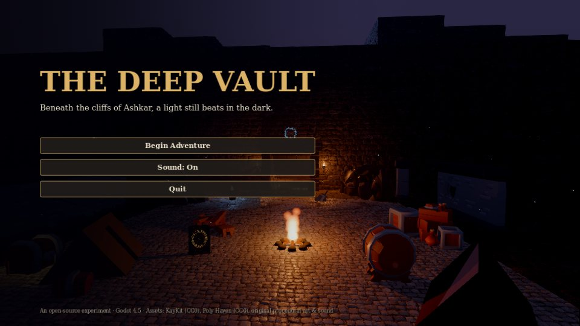
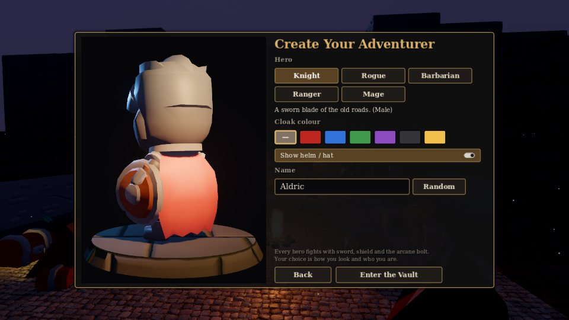
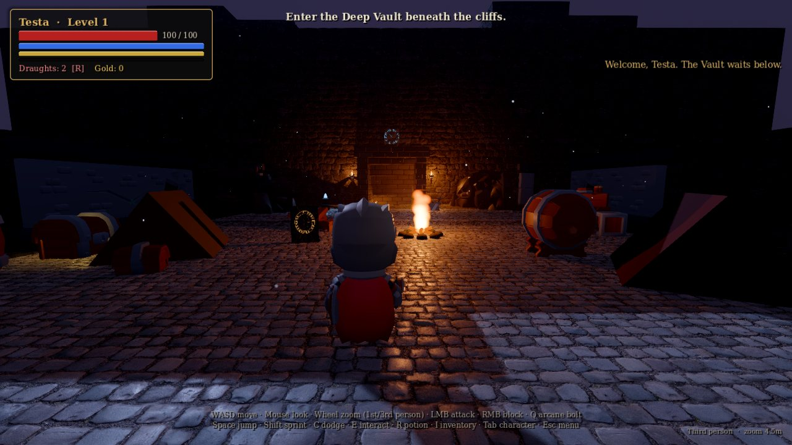
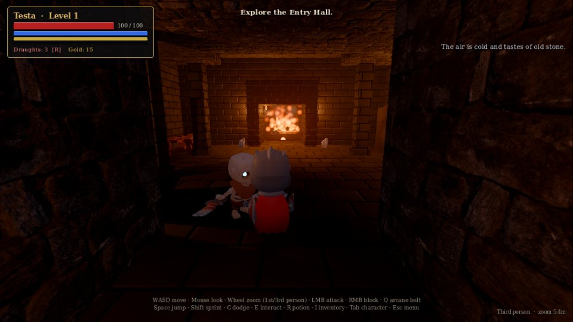
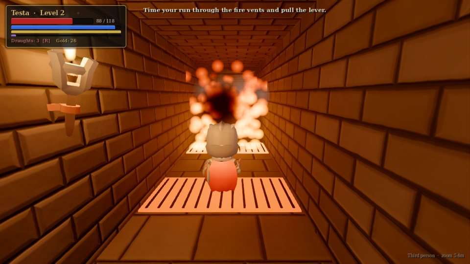
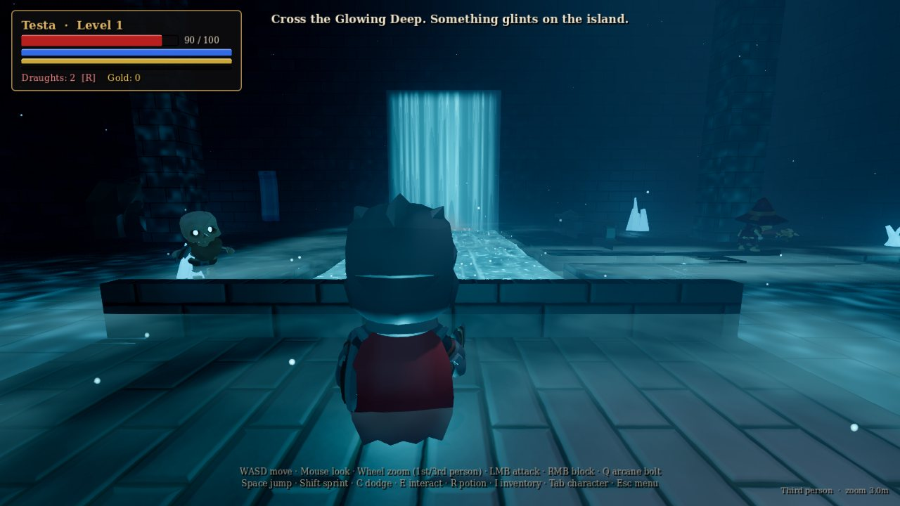
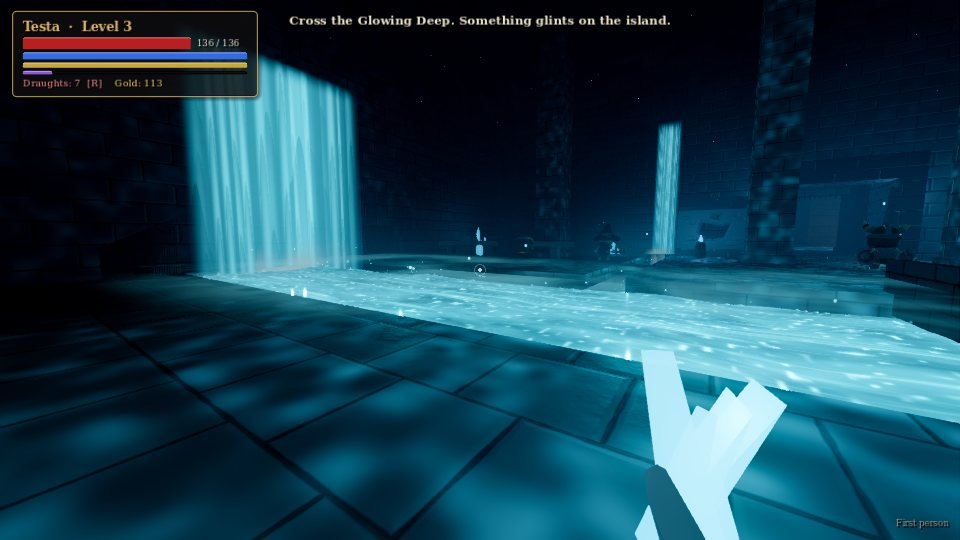
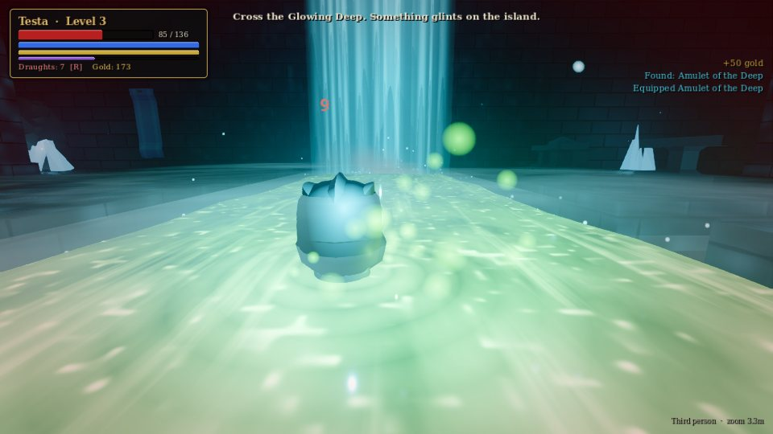
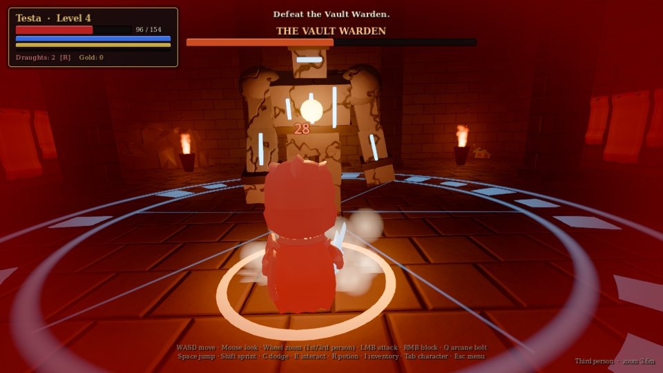
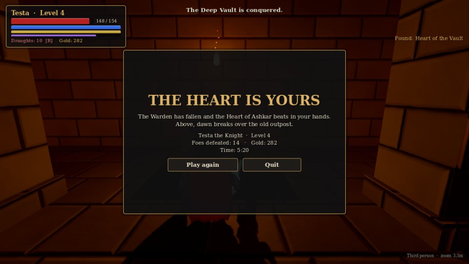

# Bobek's Adventure

*(Project 001, "The Deep Vault")*

A small, atmospheric 3D fantasy dungeon crawler built with **Godot 4.5** during an overnight autonomous-development experiment (Project 001).

Descend from a ruined outpost at dusk into the Vault of Ashkar. Fight risen skeletons, time your run through breathing fire vents, arm yourself in the Armory, and cross **the Glowing Deep**, a cavern split by a river of living light. Then face the Vault Warden for the Heart of the Vault.

## Play it

**On iPad (or any modern browser):** open **https://whitewolfcreativeworks-coder.github.io/The-deep-vault-game/** in Safari. The first load downloads about 66 MB.
- **Touch:** the on-screen controls appear as soon as you touch the screen. Use both thumbs at once, move with the left and look with the right:
  - left thumb to move (push all the way to sprint)
  - swipe on the right side to look
  - pinch to zoom between first and third person
  - buttons for attack, block, bolt, dodge, jump, use and potion
- **Magic Keyboard / trackpad:** works like a computer. If Safari won't lock the pointer, you drag to look and tap to attack instead. The arrow keys also turn the camera.
- **Tip:** in Safari choose Share → *Add to Home Screen* to play full-screen.

The browser version uses Godot's web renderer, which has no volumetric fog or light shafts. Everything else is the same game.

**Download a build** (`BobeksAdventure-Windows.zip`, `-macOS.zip`, `-Linux.zip`) from the [`builds` branch](https://github.com/whitewolfcreativeworks-coder/The-deep-vault-game/tree/builds): Windows, macOS (Apple Silicon and Intel) and Linux zips, with run instructions in that branch's README. Only the Linux build has actually been launched and tested so far.

**Run from source (any OS):**

1. Install [Godot 4.5.1 (standard edition)](https://godotengine.org/download/archive/4.5.1-stable/).
2. Clone this repository.
3. Open Godot, choose **Import**, and select `game/project.godot`.
4. Press **F5** (Play). The first import takes a minute.

Alternatively, run `godot --path game` from the repo root.

A GPU with Vulkan gives the full look (volumetric fog and light shafts). Without Vulkan, Godot falls back to OpenGL automatically and everything except volumetric fog still works.

## Screenshots

*Captured by the automated test harness under software rendering (no GPU), so expect smoother lighting and higher frame rates on real hardware.*

| | |
|---|---|
|  |  |
|  |  |
|  |  |
|  |  |
|  |  |

## Controls

| Input | Action |
|---|---|
| WASD | Move. **Strafe movement by default**: your hero keeps facing where you look, sidestepping and backpedaling (switch to "Free" movement in the pause menu) |
| Mouse (or arrow keys) | Look |
| **Mouse wheel** (pinch on iPad) | Zoom smoothly from **first person**, to behind your hero, to a **high overhead view** (the camera rises and looks down past ~4.5 m) |
| V (VIEW button on iPad) | Step through the three views: first person → behind → high |
| Left mouse | Sword attack (press again mid-swing for a 3-hit combo) |
| Right mouse (hold) | Raise shield / block. It comes up instantly (even mid-swing) and stops frontal blows completely. Raise it just as an enemy strikes (their eyes flash when they wind up) to **Parry**: no damage, the attacker staggers, +12 mana |
| Q | Arcane bolt (homing, costs mana) |
| **X** | **Hero special ability** (on a cooldown; big purple button on touchscreens) |
| Space / Shift / C | Jump (tap again in the air to double jump; press against a ledge to climb up) / Sprint / Dodge roll |
| E | Interact (chests, levers, shrines, inscriptions) |
| R or 1 | Drink a healing draught |
| F or 2 | Drink a mana potion |
| I or Tab | Inventory and character sheet |
| Esc | Pause menu |

Basic gamepad support is included: left stick to move, A jump, X attack, LB block, RB spell, B dodge, Y interact, right-stick click special.

## What's in it

- **Opening movie (new).** After you create your hero, a short real-time movie plays with your own character. It has a Skip button.
  - The sun rises over the mountains into a quiet valley and Bobek's little cabin.
  - Your hero wakes up in pajamas, changes into their outfit, brushes their teeth, boils the kettle and sits down for a cup of tea.
  - Then they walk out whistling down the forest trail, find a forgotten portal that flickers to life, and step through to arrive at the gates of the Deep Vault.
- **Portal to Level 2.** After you defeat the Warden and claim the Heart, the wall behind the altar grinds open on an ancient portal. Walk into it and you come out of the portal in the Goblin Forest.
- **Character creator.** A big **Surprise me!** button gives you a random look, colours and a silly Bobek name. There are 60 names, from *Bobek McBobface* and *Bobekasaurus Rex* to *Bobek the Kettle Master*.
- **Level 2: The Goblin Forest (new).** Win the Vault and a portal opens behind the altar. Step through to arrive in a sunlit forest valley.
  - **The valley:** hills, a road with lantern posts, a stream with a stone bridge, about 650 trees (green and autumn), and mountains all around.
  - **The Warren:** its beacon fire burns on the northern ridge, in view straight up the road from the portal.
  - **Five NPCs, five quests.** This is the first introduction to questing. A gold **!** means a new quest, **?** means it's ready to hand in, and the quest list appears on the left.
    1. **Ranger Fenn** (by the portal): *Goblin Trouble*. Defeat six goblins.
    2. **Bram the Woodcutter** (lumber camp, west): *Bram's Stolen Axes*. Recover three axes from the goblin camps.
    3. **Old Maera** (herbalist's hut by the stream, east): *Moonpetals*. Gather five glowing flowers.
    4. **Tobble the Merchant** (robbed wagon on the road): *The Stolen Strongbox*. It's in the Warren.
    5. **Captain Aldric** (Warren gate, north): *Into the Warren*. Defeat Chief Gruk. He only unbars the door after Fenn's quest is done.
  - **Rewards:** XP, gold, potions, and gear from the same random loot tables as chests, up to Legendary.
  - **The Goblin Warren** is the zone's dungeon. It has an entry cavern, a goblin den, and Chief Gruk's hall. Gruk calls for help at half health, and his reward chest sits behind his throne.
  - **Goblins:** Goblin Cutters, Goblin Archers, Goblin Brutes and Chief Gruk. They're built on the hero rigs, with green skin, pointy ears and warpaint.
  - **Saving:** the level, quest progress, collected quest items and defeated goblins are all saved in your slot.

- **Hero special abilities (new).** Each hero has a special move on its own button, with a cooldown:
  - **Rogue: Backstab** (6 s). Vanish in shadow, reappear behind the nearest enemy and strike for a 5x critical, with a crossed slash, slow motion and a purple flash.
  - **Mage: Shadow Step** (5 s). Blink up to 13 m the way you look (or move). An implosion at the start leaves a shadow pool that keeps burning enemies; a shadow nova, light pillar and shockwave hit everything within 5 m of where you land.
  - **Knight: Shield Charge** (7 s). Rush forward inside a barrier of light, smashing and stunning everything in the way, and finish with a shield slam shockwave.
  - **Barbarian: Whirlwind** (8 s). A burning vortex: four spinning hits on every enemy around you, the last one hurling them away with a pillar of fire.
  - **Ranger: Volley** (7 s). Two waves of nine arrows that burst on impact, damaging enemies nearby.
- **Double jump.** Tap jump for a small hop; tap again in the air for a much bigger jump (about 3x higher).
- **Three save slots (new).** Each hero is saved where you left off: looks, level, gear, bag, potions and gold, which chests are open, which enemies are defeated, the last shrine and the exact spot you were standing.
  - The game autosaves every 15 seconds, at shrines, on level-up, when you pause, and when the app is closed or switched away from.
  - The title screen has **Continue**, which shows a card per slot with name, hero, level, where you are and play time. **New Adventure** uses an empty slot, or asks which one to replace when all three are used.
  - The pause menu has **Save & exit to title**, for switching heroes.
  - Saves live on the device: in the browser/iPad app they are kept in the browser's site storage. Clearing Safari's website data deletes them.
- **Touch controls you can arrange (iPad).**
  - The combat buttons sit in a tight cluster around ATTACK in the bottom-right corner, so the rest of the right side is free for steering the camera with your thumb.
  - A **zoom slider** on the left edge goes from first person (top, "EYES") to the high overhead view (bottom). Pinching works too, anywhere on the screen.
  - **Hold any button still for about a second:** a yellow ring fills, the button turns yellow, and you can slide it anywhere. Let go and it stays there; positions are saved on the device.
  - The pause menu has **Arrange touch buttons** (move any button, including ATTACK and BLOCK) and **Reset touch buttons**.
- **Combat feel.** Hero weapons are about 45% longer with matching reach, and every swing leaves a glowing slash trail (in the weapon's rarity colour) so you can see what you hit. When a wall is behind you, the camera swings up and over instead of squashing into the back of your head.
- **Character creator** in tabs (Hero, Body, Hair, Face, Colours). The preview zooms in on the face while you pick hair and face details, and can be dragged to spin. Picking any hair option takes the helm off so you can see it.

- **Random loot (new).**
  - Weapons, armor, trinkets and *skins* come in five rarities: Common, Uncommon, Rare, Epic and Legendary.
  - Each piece rolls random bonuses: attack, defense, health, mana, mana regeneration, critical hits, life steal and spell power.
  - Loot drops from monsters and from 13 chests (plus a reward chest after the boss). Rare and better drops shoot a beam of light.
- **Gear changes your look.** Weapons glow in their rarity colour, armor changes your shield and colours, and Epic or Legendary gear gives you an aura. Skins transform you: Lizardfolk, Bone Ward (you become a skeleton), Gilded, Spectral, Ember and Frost.
- **Healing and mana potions.** Your sword hits recharge mana, so the rhythm is: cast, slash to recharge, cast again.

- Character creation with a live 3D preview: five heroes, skin tone (9, including goblin green and frost blue), 8 hair styles, 10 hair colours, face details (beard, mustache, eyepatch, scar, war paint, rosy cheeks), build (skinny to big) and height (short to tall) sliders. Hair styles: natural, curly, long, ponytail, buns, spiky, mohawk, bald, armor & cloak colour, helm toggle, a "Randomize look" button and a Bobek-themed random name.
- App icon, loading screen and title art use the Bobek's Adventure cover art (green-hooded Rogue).
- A continuous first-/third-person camera that collides with walls.
- Real-time combat: a combo chain, block with guard break, dodge with i-frames, a homing spell, hit-stop, screen shake and damage numbers.
- Four enemy types plus a three-phase boss. Skeletons rise out of the floor, mages kite and shoot, the Revenant telegraphs heavy slams, and the Warden leaps, summons and enrages, then shatters into physics debris.
- XP and levels, a gear progression (3 weapons, 3 armors, 1 artifact), gold, potions, an inventory and a character sheet.
- Checkpoint shrines, death and respawn, lore inscriptions, and a victory screen.
- **The Glowing Deep**:
  - a flowing luminous river shader with depth foam, ripples where you wade, and a colour shift when you wear the amulet
  - glowing waterfalls and feeder channels, drifting mist, rising motes and volumetric fog with a light shaft
  - caustic light on the stone
  - the river burns you, or heals you if you carry the Amulet of the Deep
- Dynamic torchlight, firelight, fire-vent traps, and synthesized sound and music.

## Repository layout

```
game/        the Godot project (scenes, scripts, shaders, assets)
docs/        design notes, licenses, known issues, experiment report
tools/       build.sh (exports), run_tests.sh (automated playthrough), make_audio.py (sound synthesis)
```

## Build and test

```bash
GODOT=/path/to/godot tools/build.sh all        # export Windows / Linux / macOS into builds/
GODOT=/path/to/godot tools/run_tests.sh flow   # scripted playthrough to victory, with screenshots
GODOT=/path/to/godot tools/run_tests.sh shots  # screenshot tour of every area
```

The test drives the real game through input actions (movement, mouse-wheel zoom, attacks, interaction) and writes `results.json` plus screenshots.

## Docs

- [docs/DESIGN.md](docs/DESIGN.md): the adventure, systems, the river chamber, and decisions and substitutions
- [docs/LICENSES.md](docs/LICENSES.md): dependencies, asset sources and licenses
- [docs/KNOWN_ISSUES.md](docs/KNOWN_ISSUES.md): what's rough or unfinished
- [docs/EXPERIMENT_REPORT.md](docs/EXPERIMENT_REPORT.md): how the overnight autonomous build went

## Credits

- Characters, weapons and dungeon props: **KayKit** by Kay Lousberg (CC0)
- Textures: **Poly Haven** (CC0)
- Shaders, level, Warden, sound and music: original, made for this project
- Code: MIT
